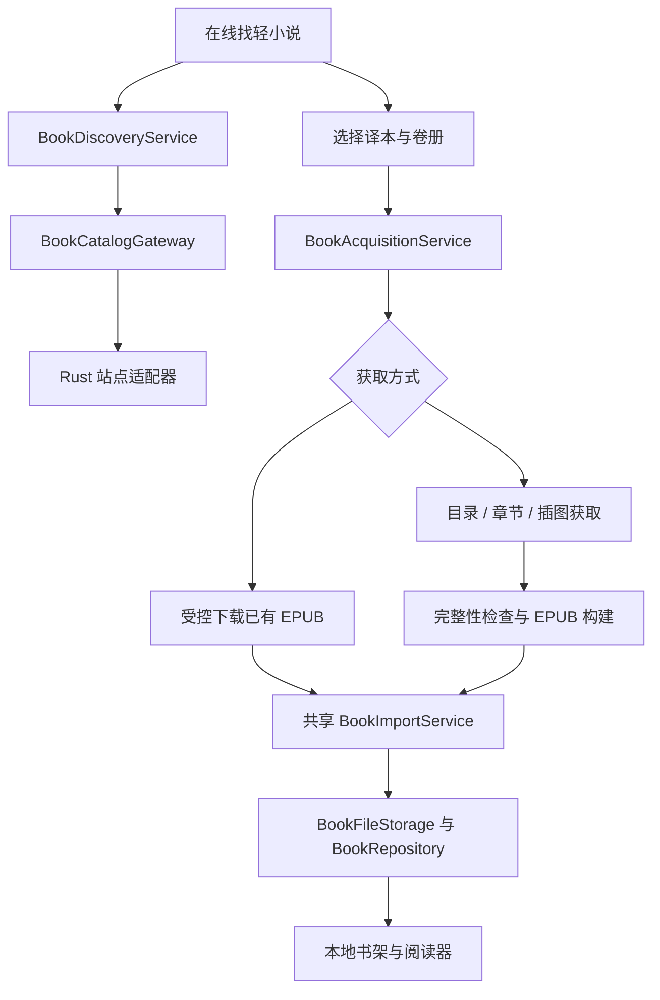

# 日本轻小说中文译本的在线搜索与导入设计

状态：初始完整设计；首版代码已实现，实际范围与验证结果以 [实施记录](online-book-discovery-implementation-plan.md) 为准。调研日期：2026-10-15。

实际模块、首版取舍、真实访问验证和交付门槛见 [`online-book-discovery-implementation-plan.md`](online-book-discovery-implementation-plan.md)。2026-10-15 的终端 HTTP 请求在 Bilinovel / Linovelib 返回 403；后续普通浏览器验证了首页和 Bilinovel 的搜索、目录及单章显示。应用内接入、提取质量与完整卷导入仍待验证，计划已加入独立的浏览器辅助获取路线。

目标是让用户在 LightReader 搜索日本轻小说已有的中文译本，查看系列、译本、卷册和插图信息，选择需要的卷，再把可获取内容生成或下载为 EPUB，自动加入书架离线阅读。用户指定的来源是 `bilinovel.com`、`linovelib.com` 和 `linovel.net`。默认兼容简体与繁体，展示译者及翻译类型；当前范围不增加自动翻译服务。

主线调整为“定向书源适配 → 搜索系列 → 选择译本与卷册 → 获取文件或章节 → EPUB → 现有导入管线”。书格、维基文库及 Gutenberg 不适合这个目标，移出首批书源。

## 指定书源的区别与核实结果

| 来源                                              | 本次取得的证据                                                                   | 设计定位                                                                    |
| ------------------------------------------------- | -------------------------------------------------------------------------------- | --------------------------------------------------------------------------- |
| [bilinovel.com](https://www.bilinovel.com/)       | 首页标识为“哔哩轻小说”，包含日本轻小说栏目；网页工具可读取作品详情和系列卷册信息 | 优先验证搜索、目录和中文正文获取的来源                                      |
| [linovelib.com](https://www.linovelib.com/)       | 首页同样标识为“哔哩轻小说”                                                       | 与 Bilinovel 作为同一适配器家族的候选入口；书号、目录和版本映射必须实际核对 |
| [linovel.net](https://www.linovel.net/page/about) | 官方介绍是“轻之文库”，侧重原创轻小说与作者服务                                   | 独立来源，不与前两个域名混用；暂不作为日本作品中文翻译的主搜索源            |

不能因为域名相近就认定三站可使用相同书号、登录状态、搜索接口或解析规则。Bilinovel 与 Linovelib 即使展示同一作品，也要先比对作品、卷册和章节标识，再建立来源映射；不同时向两个入口重复抓取整部作品。

普通浏览器已验证 Bilinovel 一次书名搜索、详情、目录、一个短章节显示及插图元素加载；尚未完成正文提取质量、多页章节、完整图片获取或 EPUB 联调。`robots.txt` 未能通过网页工具取得，终端探测返回 403，因此访问规则仍待核实，不能当作不存在或已允许自动采集。登录要求、限流、访问规则及内容使用条件在启用获取能力前逐项核实。

一个具体结构样例是 Bilinovel 的[《败北女角太多了！》详情页](https://www.bilinovel.com/novel/3095.html)：页面同时包含别名、系列卷册、半卷、短篇集及日版画集条目。它说明模型必须区分卷册与内容类型，不能将所有系列条目都标为“中文小说完整卷”。本次访问止于少量页面验证，没有抓取或生成整书。

## 更相关的 GitHub 参考项目

| 项目                                                                                    | 已核实的能力                                                 | 参考方式与限制                                                                                                    |
| --------------------------------------------------------------------------------------- | ------------------------------------------------------------ | ----------------------------------------------------------------------------------------------------------------- |
| [lightnovel-center/linovelib2epub](https://github.com/lightnovel-center/linovelib2epub) | 针对轻小说网页生成 EPUB，支持选卷、插图等；仓库标识 AGPL-3.0 | 最贴近用户指定来源，重点研究卷册、分页与插图模型；README 同时记录了站点适配困难，不能视为当前域名可直接运行的证明 |
| [lncrawl/lightnovel-crawler](https://github.com/lncrawl/lightnovel-crawler)             | 多来源适配、章节获取和 EPUB 生成；仓库标识 GPL-3.0           | 参考统一爬虫契约、任务状态及错误处理；“支持轻小说”不等于已经覆盖目标站点的中文译本                                |
| [readest/readest](https://github.com/readest/readest)                                   | Tauri 阅读器，包含 OPDS 与网页内容导入能力；AGPL-3.0         | 参考来源到本地书库的服务边界，不替换现有阅读器                                                                    |
| [auto-novel/auto-novel](https://github.com/auto-novel/auto-novel)                       | 轻小说机翻站，包含网络、文库及本地小说工作流                 | 仅作翻译类型和版本管理参考；本需求先搜索已有译文，无需部署机翻系统                                                |

建议独立实现少量 Rust/TypeScript 适配器，参考上述项目的模型和流程。本阶段不默认打包额外的 Python、Chromium 或 OCR 运行时；浏览器辅助模式先验证系统 WebView，如需外部运行时再评估安装包、维护成本和许可证。代码许可证与内容来源的授权信息分别记录。

## 用户流程

1. 书架增加“在线找轻小说”入口，进入懒加载的 `/discover`。原 `/search` 保持本地全文搜索用途。
2. 输入中文标题、日文原标题、别名或作者；按来源实际能力发起搜索，不声称每个站点都支持全部字段。
3. 结果以系列展示，标注来源、原作语言、已有中文译文、连载状态；漫画、画集和中文原创不混入默认日本小说结果。
4. 展开系列，查看卷序、卷名、译者/翻译组、简繁、人工/机翻/混合/未知及目录状态。信息不足明确显示“未知”，不推断成人工译本或正版译本。
5. 选择一卷或多卷，默认按卷生成独立 EPUB，保留彩页、插图、目录和署名。显示预计章节数与获取方式。
6. 获取完成后复用现有校验、去重、文件提交和数据库入库流程，进入书架直接阅读。

| 状态                                 | 页面表现                               |
| ------------------------------------ | -------------------------------------- |
| 搜索中                               | 各来源独立加载，返回结果先显示         |
| 无结果                               | 提示尝试别名、繁体标题或其他来源       |
| 一源失败                             | 保留其他结果，支持单源重试             |
| 所有来源失败 / 离线                  | 与“无结果”区分，本地书架仍可使用       |
| 有可获取 EPUB                        | “下载并加入书架”                       |
| 可获取的完整网页卷册                 | “生成 EPUB 并加入书架”                 |
| 只有试读、正文受限、无法确认获取条件 | 展示范围与具体原因，提供“前往来源网站” |
| 一卷缺章或正文解析异常               | 显示失败卷与章节，不宣称整卷成功       |
| 文件重复                             | “已在书架”，可直接打开                 |

多卷任务按卷显示独立结果：已成功的卷不因另一卷失败而回滚。新文案进入现有中英文消息目录，搜索、卷选择与取消操作支持键盘和可访问状态播报。外部来源通过平台 `ExternalLinkService` 打开系统浏览器，不在阅读 WebView 中加载站点脚本。

## 与当前项目的接入边界

| 边界                                                   | 当前能力                                        | 拟议变化                                            |
| ------------------------------------------------------ | ----------------------------------------------- | --------------------------------------------------- |
| `src/features/library/services/book-import-service.ts` | 六种格式、哈希去重、解析、提交及补偿回滚        | 提取不依赖文件选择器的 `importBytes()`              |
| `src/storage/book-file-storage.ts`                     | AppData 暂存、提交、读取和清理                  | 新增专用获取暂存 Adapter，按句柄管理下载及生成结果  |
| `src/features/library/services/library-services.ts`    | 桌面 SQLite / Web IndexedDB 装配                | 注入目录 Gateway、获取服务与 EPUB 构建服务          |
| `src-tauri/src/ai.rs`、`src-tauri/Cargo.toml`          | 已有 `reqwest`、流式响应与 IPC Channel 使用方式 | 独立的来源客户端、取消、正文/插图获取和流式文件下载 |
| `src/app/router/routes.tsx`                            | 书架及本地全文搜索路由                          | 新增 `/discover`                                    |

`BookImportService.importSelectedBook()` 当前是私有方法，公开接口调用文件选择器；网络 URL 不能直接传进去。共享入口接收受控的书名字节与可选来源记录，保留原有校验、SHA-256 去重、元数据解析、正式文件提交在数据库之前、提交结果不确定时保留正式文件的约定，见 [`book-import.md`](book-import.md)。



建议新增模块，均为拟议文件：

```text
src/features/discovery/
  domain/novel-catalog.ts
  domain/acquisition-job.ts
  discovery-page.tsx
  hooks/use-book-discovery.ts
  services/book-discovery-service.ts
  services/book-acquisition-service.ts
  services/epub-builder-service.ts
src/platform/catalog/
  book-catalog-gateway.ts
  tauri-book-catalog-gateway.ts
src/storage/acquisition-staging-storage.ts
src-tauri/src/catalog/
  mod.rs
  http.rs
  acquisition.rs
  sources/bilinovel.rs
  sources/linovel.rs               # 独立的后续来源
```

React 不直接调用 Tauri、SQL 或站点接口。Rust 管理请求与来源规则，TypeScript Gateway 校验 DTO，应用服务编排获取与导入。搜索结果属于页面短期状态；Zustand 只保存需要跨页面保留的筛选偏好，不保存数据库业务实体。

## 系列、卷册与译本模型

以下 TypeScript 是拟议的领域契约，不是已经实现的接口。跨 IPC 对象使用 Zod 校验，Rust 对应定义有界字段和枚举。

```ts
interface NovelSeries {
  sourceId: string;
  sourceNovelId: string;
  title: string;
  originalTitle: string | null;
  aliases: string[];
  authors: string[];
  originalLanguage: string | null;
  contentKind: 'novel' | 'manga' | 'artbook' | 'unknown';
  sourcePageUrl: string;
}

interface NovelVolume {
  sourceNovelId: string;
  sourceVolumeId: string;
  title: string;
  order: number; // 来源目录中的顺序，不是从标题截取的整数
  kind: 'main' | 'side-story' | 'collection' | 'unknown';
  language: string | null;
  script: 'hans' | 'hant' | 'mixed' | 'unknown';
  translators: string[];
  translationMethod: 'human' | 'machine' | 'mixed' | 'unknown';
  editionLabel: string | null;
  chapterCount: number | null;
  availability: 'complete' | 'partial' | 'unknown';
}

type AcquisitionPlan =
  | { kind: 'file'; acquisitionId: string; format: 'epub' | 'pdf' }
  | { kind: 'chapters'; acquisitionId: string; chapterCount: number }
  | { kind: 'external'; pageUrl: string; reason: string };
```

Gateway 提供 `search`、`getSeries`、`listVolumes` 和 `planAcquisition`，都接收取消信号和来源 ID；获取计划由原生端根据作品/卷册 ID 解析。不能把任意网页 URL、输出路径或远程脚本作为执行命令。

搜索以 `(sourceId, sourceNovelId)` 为身份，跨站同名作品只做候选分组；原标题、作者和别名提供匹配证据，不自动合并。区分 Web 版、文库版、重译版、外传及不同学年篇。卷册顺序支持第 0 卷、8.5 卷、上下册、短篇集，不能按文件名字符串或整数排序。

人工译本、机翻和混合译文按来源明确声明标注；没有证据就保留未知。显示语言不等于原作语言，站点“日本轻小说”栏目也不自动证明每个结果都是日文原作。简繁展示保留原文，用户输入和标题可用繁简别名协助搜索；繁简转换不能被记作另一个译者版本。

## Bilinovel / Linovelib 适配策略

先取得当前搜索表单及请求参数，再实现搜索解析；不猜测历史接口仍可用，也不按书号线性枚举。详情解析提取作品、作者、别名、目录入口和卷册；下载按钮只作为获取候选，需要继续核实它指向书文件、说明页还是登录页。

目录解析建立稳定的卷册与章节 ID、顺序和来源链接。正文采集处理“一章多页”，仅在当前章节范围内跟随分页：检测重复 URL、循环、“下一章”误判、空正文及截断。章节顺序来自目录快照，不能用并发完成顺序拼书。

站点可能使用不同域名、桌面/移动模板、访问挑战或正文混淆。[linovelib2epub 的说明](https://github.com/lightnovel-center/linovelib2epub)记录了这类适配困难，但本次没有核实其历史处理办法是否仍然有效。首版先验证可正常读取的页面结构；遇到挑战或不可读正文，返回具体失败原因，不把挑战页、乱码或广告当作章节。

适配器声明精确的页面主机、图片主机及用途；域名切换只有通过真实条目比对后才启用。`linovel.net` 使用独立解析器和身份命名空间，不继承哔哩轻小说的正文规则或凭据。

## 章节到 EPUB：首版必要链路

指定来源主要需要验证网页内容获取，因此“章节组书”属于本需求的首版能力，不能只完成书目搜索或把它无限延期。

1. 用户选卷后保存目录快照，包括来源、卷 ID、章节 ID、顺序和预期章节数。
2. 单来源顺序获取正文，使用固定并发上限、站点适用的间隔和有限重试。图片使用独立的小队列与大小预算。
3. 站点解析器只输出有界结构化内容：段落、标题、强调、注音、译者注和图片引用；原始网页脚本及任意 HTML 不进入阅读器。
4. 逐章校验分页结束、正文非空、章节身份和图片状态。正文缺失使该卷失败；图片缺失提供“重试 / 明确接受缺图”的选项，不能悄悄宣称完整。
5. EPUB 构建服务生成 package、navigation、spine、XHTML、封面和本地插图，重写链接并保留来源及译者署名。当前项目的 `fflate` 只是 ZIP 工具，需要补齐 EPUB 规范结构与验证。
6. 每卷构建完成后走共享导入服务；生成文件使用固定章节/资源顺序，控制易变字段，避免同一快照每次因随机 ZIP 元数据而产生不同哈希。

卷级来源修订指纹由章节列表、顺序和内容摘要计算，不能只使用“站点最后更新时间”。已有相同快照的卷提示打开本地版本；修订内容生成新版本供用户选择，不直接覆盖已有批注和阅读定位。两个不同译本也不能因卷名相同而覆盖。

任务状态：

```text
queued → resolving → fetching → validating → building → importing
                                                   → completed / duplicate
排队、解析、采集与构建可取消；失败显示具体卷册与原因，并允许重试。
```

取消信号必须中止原生请求、排队资源和构建任务；进入数据库提交阶段后完成当前卷并返回真实结果，不能因取消清除已入库文件。首版不承诺退出应用后的续传或自动追更，当前会话中可以仅重试失败章节。后续追更先做版本对比与用户选择，阅读位置迁移另行设计。

## 文件、持久化与原生网络

下载及构建暂存只位于 `$APPDATA/light-reader/tmp/acquisitions/<task-id>/`，本地路径由 UUID 生成；上游文件名、章节标题及 `Content-Disposition` 不参与路径拼接。暂存操作按不透明句柄寻址，校验路径和符号链接边界。入库完成后清理暂存，启动时清理不被活跃任务引用的过期获取数据。

建议单个活跃卷册任务、导入串行。元数据响应初始上限 2 MiB、单章清理后内容 2 MiB、单张图片 10 MiB、每卷最多 500 章、每章最多 20 页、单卷全部采集资源 128 MiB、最终 EPUB 64 MiB；目录超限时显示原因，不静默截断。以上是待样例验证的初始预算。本地导入目前默认上限为 256 MiB；在线文件上限不得超过它。下载流式落盘不代表现有解析器无需完整读取 `Uint8Array`。

成功来源信息属于业务数据，拟新增 `book_origins`：本地 `book_id`、`source_id`、作品/卷/译本标识、来源页面、修订指纹、译者、来源声明及获取时间。新书和来源通过 Repository 事务共同写入；重复哈希追加来源关联，不修改用户编辑的书籍数据。来源删除随书籍级联，不存登录凭据、临时下载令牌或书籍 BLOB。

当前迁移到 `0012`，实施时选择下一个未占用编号；同步更新迁移注册、数据库版本、备份恢复检查与 Web IndexedDB 契约。阅读器继续读取既有 Book；系列和来源元数据不扩散为阅读引擎依赖。

桌面请求走 Rust，不放宽当前 WebView 的公网 CSP。现有 `reqwest` 关闭默认 features，仅显式启用 `json`、`stream`；公网 HTTPS 前检查最终 feature 合并与 TLS 支持，参见 [reqwest 官方文档](https://docs.rs/reqwest/0.13.0/reqwest/#optional-features)。

原生端检查每个请求和重定向的用途、主机与实际连接地址，拒绝公共来源跳转至内网/环回/链路本地地址；分页和图片同样检查。内容长度未知也逐块限额。超时、429、挑战页、正文乱码和授权受限使用不同错误码，限制重试总量，遵守来源访问规则。内容可在网页阅读不自动证明可批量导出；需要登录、购买或来源允许条件未核实的获取计划保留外部入口，不转移用户会话或解密受保护文件。

静态 Web 版本不能直接复用 Tauri 命令或假设第三方 CORS 可用。首版优先桌面，Web 显示来源能力是否可用；若后续增加同源目录服务，沿用同一 DTO 与请求限制，不能提供任意 URL 转发接口。

## 实施顺序与验收

| 阶段             | 交付                                                                      | 完成条件                                                                             |
| ---------------- | ------------------------------------------------------------------------- | ------------------------------------------------------------------------------------ |
| M0：指定来源验证 | Bilinovel 搜索、详情、目录、正文分页及插图样例；对照 Linovelib 身份与结构 | 真实验证获取条件和可读正文，记录哪些环节可用；不能以 GitHub README 替代证据          |
| M1：单卷闭环     | 一个已验证来源、`/discover`、选卷、章节获取、EPUB 构建、入库与来源记录    | 完整卷含目录和插图，可在当前阅读器离线打开；缺章、取消、重复导入与失败恢复有明确结果 |
| M2：译本与多卷   | 别名、原作/译文语言、译者和版本筛选、多卷独立任务                         | 不混淆文库/Web 版、半卷、外传、画集与中文原创；成功卷不受失败卷影响                  |
| M3：扩展来源     | 验证后的备用入口、独立 Linovel 适配器或 OPDS                              | 不重复采集已映射内容，各来源权限、凭据、解析及错误隔离                               |

必要测试包括搜索请求参数与中文编码、站点字段缺失、源域名映射、旧查询覆盖、新旧目录修订、章节分页循环、最后一页判断、插图位置与缺图、标题/卷序、EPUB 链接和资源完整性、取消清理、超限、数据库回滚及相同快照重复导入。

关键用户流程是“搜索 → 系列 → 选卷 → 获取与组书 → 入库 → 阅读 → 断网后重开”。使用自建有界 HTML 和可再分发的文字/图片做 CI 夹具，不提交小说正文或站点会话。真实站点冒烟验证单独记录；EPUB 需结构校验并在现有 Foliate 阅读器中验证目录、正文、插图和注音。

本次仅修订设计文档及入口。实现阶段按 [`lightreader-verify-efficiently`](../skills/lightreader-verify-efficiently/SKILL.md) 选择检查，并验证新增 Rust、迁移和真实原生获取行为。
